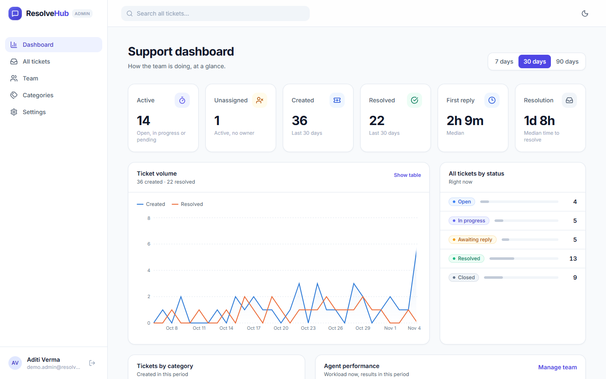
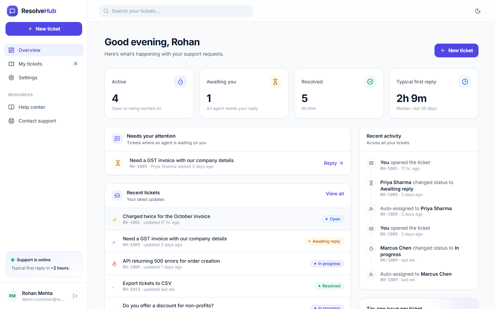
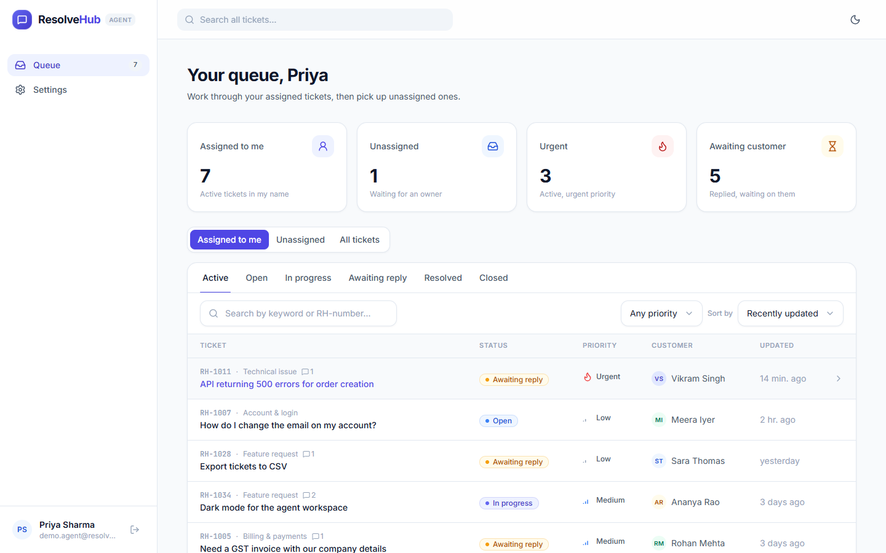
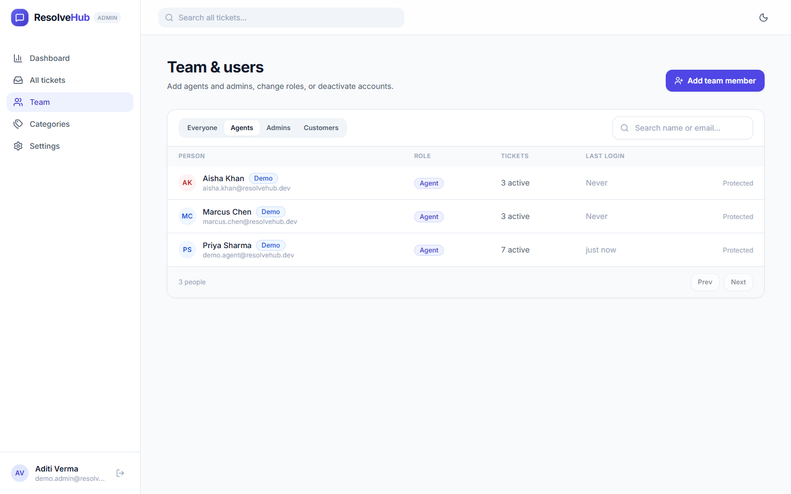
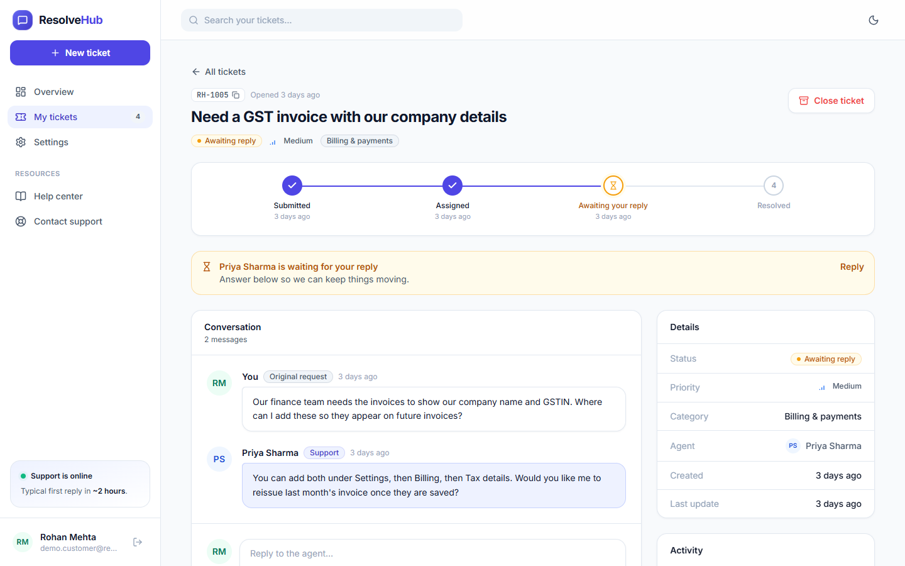
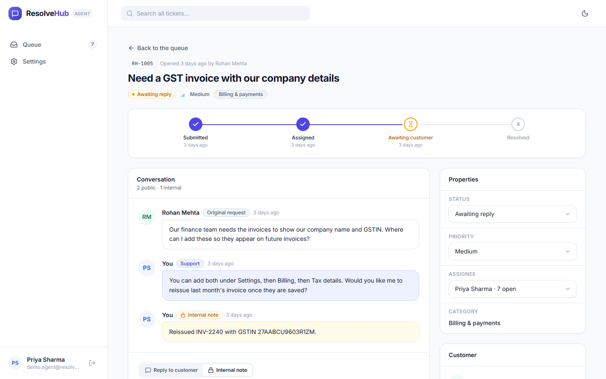
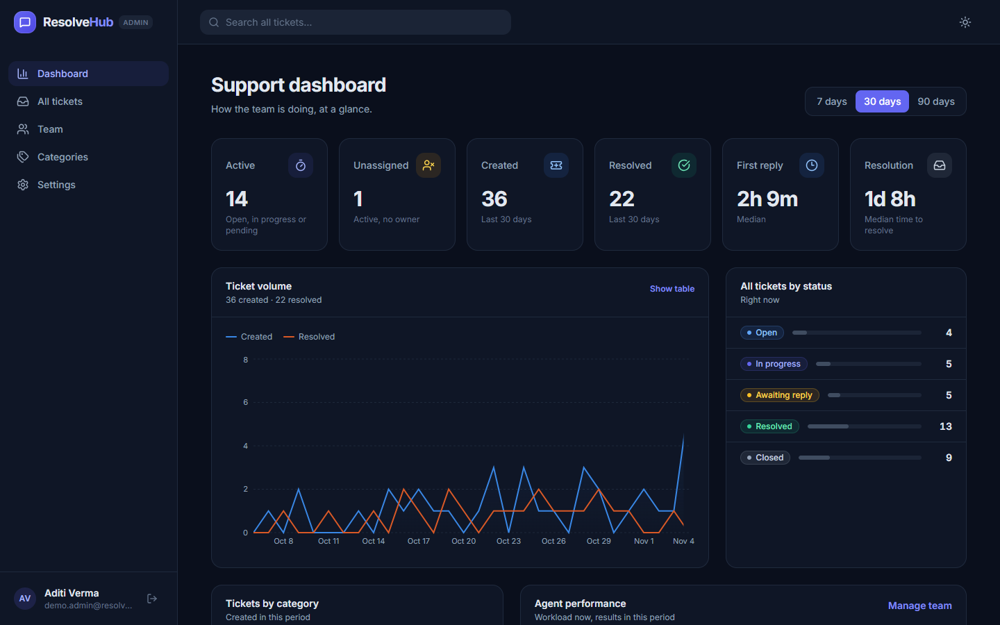
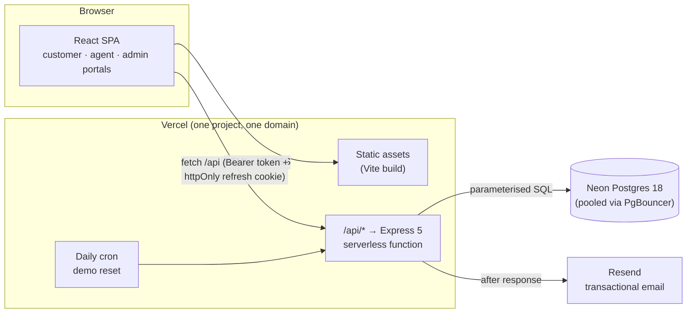
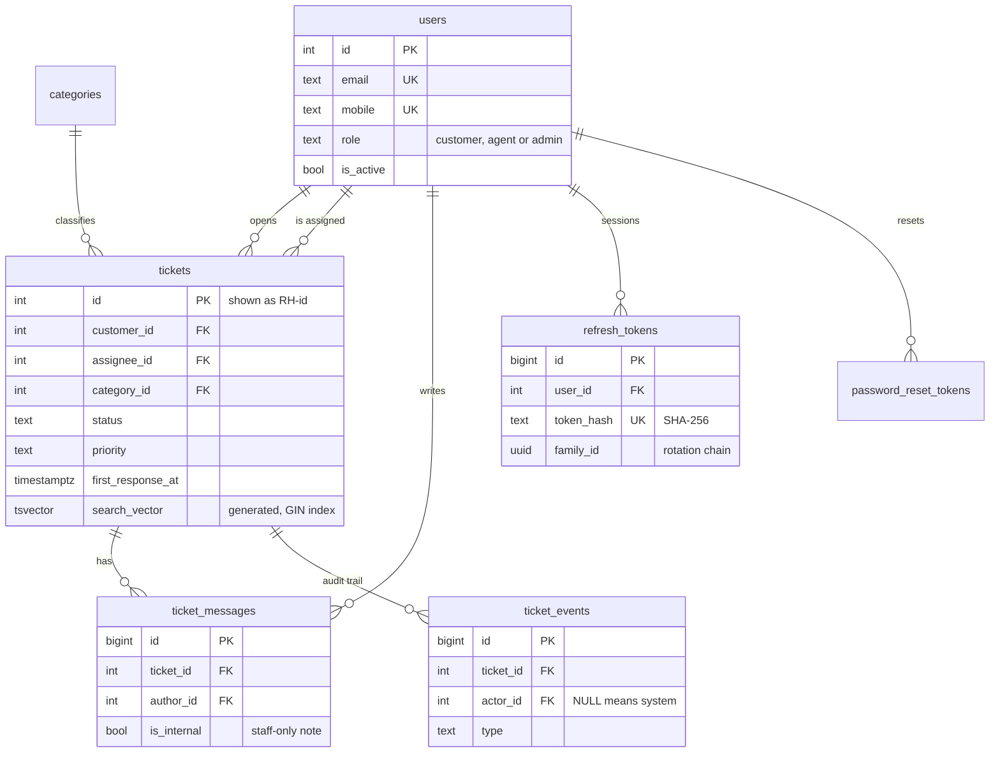

# ResolveHub

**A customer support and ticketing platform with separate portals for customers, support agents and admins.**

[](https://github.com/1devchoudhary/ResolveHub/actions/workflows/ci.yml)


**Live demo:** https://resolvehub-sigma.vercel.app · **API reference:** https://resolvehub-sigma.vercel.app/api/docs

| Portal | Login | One-click demo account |
|---|---|---|
| Customer | [/login](https://resolvehub-sigma.vercel.app/login) | `demo.customer@resolvehub.dev` |
| Agent | [/agent/login](https://resolvehub-sigma.vercel.app/agent/login) | `demo.agent@resolvehub.dev` |
| Admin | [/admin/login](https://resolvehub-sigma.vercel.app/admin/login) | `demo.admin@resolvehub.dev` |

Password for all demo accounts: `Demo@1234`. Every login page also has a **Try the demo** button. Demo data is reset every night.



---

## What it does

**Customers** open tickets, follow progress on a status timeline, reply to agents, and close or reopen resolved tickets.

**Agents** work a personal queue (new tickets are auto-assigned to whoever has the lightest load), reply or leave internal notes the customer never sees, and change status, priority and assignee.

**Admins** see volume and response-time analytics, manage the team (create agents, change roles, deactivate accounts) and maintain ticket categories.

Every change to a ticket is recorded in an audit trail, and email notifications go out for new tickets, replies, assignments and resolutions.

| Customer | Agent | Admin |
|---|---|---|
|  |  |  |
|  |  |  |

## Engineering highlights

- **Auth done properly:** 15-minute JWT access tokens kept in memory; opaque refresh tokens stored only as SHA-256 hashes in an httpOnly cookie, **rotated on every use with reuse detection** (a replayed token revokes the whole session family). Timing-safe login that doesn't reveal which emails exist.
- **Raw SQL with `pg`, no ORM:** parameterised queries, constraints that enforce the rules (`CHECK`, `UNIQUE`, foreign keys), and versioned SQL migrations.
- **Concurrency-safe auto-assignment:** the least-loaded agent is picked with `FOR UPDATE SKIP LOCKED` inside the same transaction as the insert, so simultaneous tickets spread across agents.
- **Row-level locking** (`SELECT … FOR UPDATE`) on every read-modify-write of a ticket, so concurrent updates queue up instead of overwriting each other. A test fires three updates at once to prove it.
- **Ticket lifecycle as a pure state machine** with role-based transitions (customers can close or reopen within 7 days; only admins can reopen closed tickets), unit-tested separately from the database.
- **Postgres full-text search** through a generated, weighted `tsvector` column with a GIN index; searching `RH-1042` jumps straight to that ticket.
- **Rate limiting shared across serverless instances**, backed by an `UNLOGGED` Postgres table with one atomic UPSERT per request, so it needs no Redis.
- **Consistent API contract:** Zod validation middleware, one response envelope, a central error handler that never leaks SQL or stack traces, and request IDs in logs and response headers.
- **71 integration tests** (Vitest + Supertest against a real Postgres) run in CI on every push, alongside lint and the frontend build.

## Architecture



The SPA and the API share one domain, so the refresh cookie is first-party and no CORS preflight is needed in production. Inside the API, each feature is a module with **routes → controller → service → repository**:

- the controller only translates HTTP;
- the service holds the business rules and transactions;
- the repository is the only place SQL lives.

More detail: **[docs/architecture.md](docs/architecture.md)** (request lifecycle, auth flow, state machine, auto-assignment, trade-offs).

### Data model



## Tech stack

| Layer | Choice | Why |
|---|---|---|
| API | Node 22, Express 5 | Async errors reach the error handler natively; small and well understood |
| Database | PostgreSQL 18 on Neon, `pg` | Relational data with real constraints; raw SQL to show what an ORM hides |
| Migrations | node-pg-migrate (plain `.sql`) | Reviewable, reversible schema history |
| Validation | Zod 4 | One schema validates, normalises (e.g. mobile → `+91…`) and strips unknown keys |
| Auth | jsonwebtoken, bcryptjs | Short-lived JWT + rotating refresh tokens |
| Logging | pino, pino-http | Structured JSON with request IDs and redaction of secrets |
| Frontend | React 19, React Router 7, TanStack Query 5, Tailwind CSS 4 | Server-state caching with polling; design tokens with dark mode |
| Charts | Recharts | Admin analytics (lazy-loaded, so customers never download it) |
| Email | Resend | Transactional email sent after the response via `waitUntil` |
| Testing / CI | Vitest, Supertest, GitHub Actions + Postgres service | Integration tests against a real database |
| Hosting | Vercel (static + serverless function + cron) | One deploy for the SPA and the API |

## Running it locally

Prerequisites: Node 20+, and a PostgreSQL database (local, Docker, or a free [Neon](https://neon.tech) branch).

```bash
git clone https://github.com/1devchoudhary/ResolveHub.git
cd ResolveHub

# API
cd backend
npm install
cp .env.example .env              # fill in DATABASE_URL(_POOLED) and JWT_ACCESS_SECRET
npm run migrate:up                # create the schema
node scripts/seed.js --yes        # optional: demo users and 36 realistic tickets
npm run dev                       # http://localhost:8000/api/health

# Frontend (second terminal)
cd ../frontend
npm install
npm run dev                       # http://localhost:5173 (proxies /api to :8000)
```

Without `RESEND_API_KEY`, emails (including password-reset links) are printed in the API terminal instead of being sent.

### Tests

```bash
cd backend
npm test        # needs DATABASE_URL_TEST: a separate database, because tests truncate tables
npm run lint
```

## Deployment

One Vercel project built from the repo root: [`vercel.json`](vercel.json) builds the frontend, sends `/api/*` to [`api/index.mjs`](api/index.mjs) (which exports the Express app), and schedules the nightly demo reset.

Production environment variables:
- `DATABASE_URL_POOLED`, `JWT_ACCESS_SECRET`, `NODE_ENV=production`, `DB_POOL_MAX=3`
- `APP_URL`, `CORS_ORIGINS`
- optionally `RESEND_API_KEY` and `CRON_SECRET`

Run migrations against the database's direct URL with `npm run migrate:up`.

## Project structure

```
ResolveHub/
├── api/index.mjs              Vercel entry → Express app
├── backend/
│   ├── migrations/            versioned SQL (up + down)
│   ├── scripts/seed.js        demo dataset
│   ├── src/
│   │   ├── app.js             middleware order, routes, error handling
│   │   ├── config/            env validation (Zod), pg pool + withTransaction
│   │   ├── lib/               logger, tokens, mailer, email templates
│   │   ├── middleware/        authenticate/authorize, validate, rateLimit, errors
│   │   ├── modules/           auth · users · tickets · categories · admin · demo
│   │   └── docs/              OpenAPI document + /api/docs page
│   └── tests/                 Vitest + Supertest integration tests
├── frontend/src/
│   ├── api/                   fetch client with shared token refresh
│   ├── context/               AuthProvider
│   ├── hooks/queries/         TanStack Query hooks
│   ├── components/            ui/ design system, tickets/ shared views
│   ├── layouts/               PortalLayout + per-portal nav
│   └── pages/                 customer/ · staff/ · admin/
└── docs/                      architecture notes, screenshots
```

## Roadmap

- AI assist with the Claude API: suggested category and priority on new tickets, draft replies for agents, thread summaries
- SLA targets per priority with breach warnings, and CSAT ratings after resolution
- File attachments (signed direct-to-storage uploads)
- Server-sent events instead of polling, plus canned responses for agents
- Docker Compose for one-command local setup

## License

MIT
