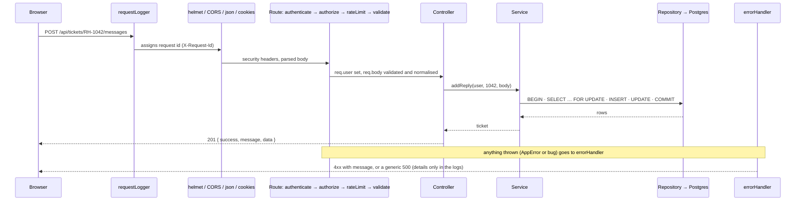
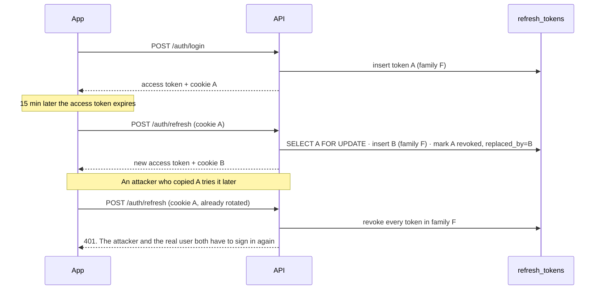
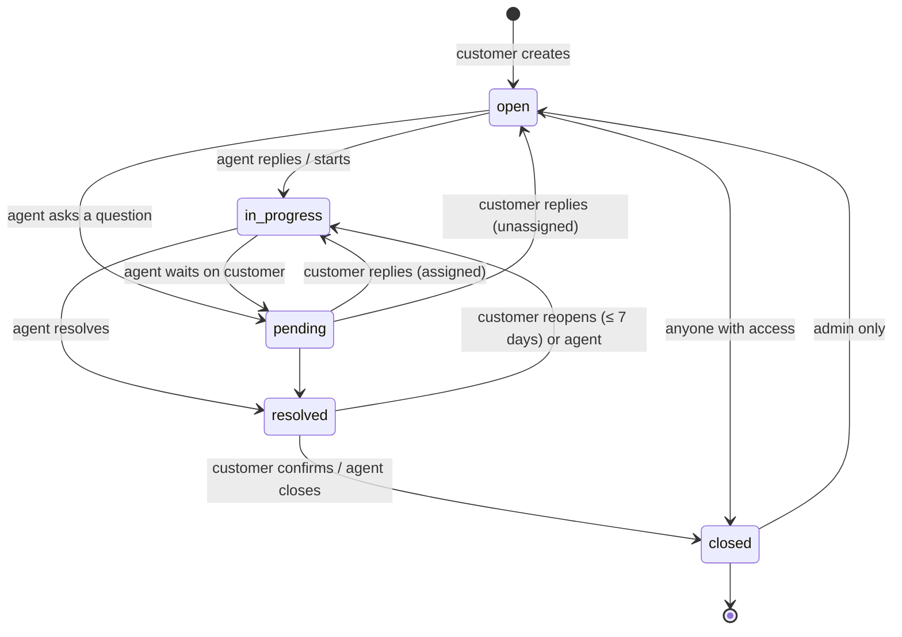

# ResolveHub architecture

How the system fits together, the decisions behind it and the trade-offs they bring. Each section ends with the questions it answers, so it doubles as a review guide.

- [1. System overview](#1-system-overview)
- [2. Backend structure](#2-backend-structure)
- [3. Authentication](#3-authentication)
- [4. Data model and migrations](#4-data-model-and-migrations)
- [5. Ticket lifecycle](#5-ticket-lifecycle)
- [6. Auto-assignment and concurrency](#6-auto-assignment-and-concurrency)
- [7. Search, lists and reporting](#7-search-lists-and-reporting)
- [8. Validation, errors and the API contract](#8-validation-errors-and-the-api-contract)
- [9. Security measures](#9-security-measures)
- [10. Frontend](#10-frontend)
- [11. Deployment on serverless](#11-deployment-on-serverless)
- [12. Testing](#12-testing)
- [13. Trade-offs and what changes at scale](#13-trade-offs-and-what-changes-at-scale)

---

## 1. System overview

One Vercel project serves two things from the same domain:

- the **React SPA**, as static files from the Vite build;
- the **Express API**, as a single serverless function that receives every `/api/*` request (`vercel.json` → `api/index.mjs` → `backend/src/app.js`).

The API talks to **PostgreSQL on Neon** through Neon's PgBouncer pooler, and sends email through **Resend**.

A request goes through the middleware in this fixed order (`backend/src/app.js`):



*Answers: what happens between a click and the database? Why does middleware order matter?* For example, `express.json()` must run before the routes or `req.body` is undefined, and the error handler must be registered last.

## 2. Backend structure

```
backend/src/modules/tickets/
  ticket.routes.js        URL + middleware chain (auth, rate limit, validation)
  ticket.controller.js    HTTP in → service call → HTTP out. No business logic.
  ticket.service.js       rules, permissions, transactions, notifications
  ticket.repository.js    every SQL statement for tickets, nothing else
  ticket.schema.js        Zod schemas for params/query/body
  ticket.stateMachine.js  pure lifecycle rules (no I/O)
```

**Why layers?** Each has one reason to change:
- Changing a URL or status code touches the controller.
- Changing a rule touches the service.
- Changing a query touches the repository.

The service can be tested without HTTP, and SQL never leaks into request handling.

**Why feature modules instead of `controllers/`, `routes/` and `models/` folders?** Everything about tickets sits in one folder, so adding a feature doesn't mean editing five directories.

**Repositories accept an optional `db` argument.** By default it's the pool. Inside `withTransaction(async (tx) => …)` the service passes `tx`, and the same repository functions then run on one dedicated connection inside `BEGIN … COMMIT`. If anything throws, the helper rolls back, and it always releases the client.

**Why not an ORM?** Raw SQL with `pg` keeps the important parts visible: locks, `RETURNING`, window functions, `FILTER` aggregates, generated columns. Every query is parameterised (`$1, $2`); identifiers that vary come from fixed allow-lists, never from input. An example is the partial-update helpers in the repositories.

## 3. Authentication

### Tokens

| | Access token | Refresh token |
|---|---|---|
| What | JWT (HS256), claims `sub`, `role` | 256-bit random string, opaque |
| Lifetime | 15 minutes | 7 days, **rotated on every use** |
| Where on the client | JavaScript memory only | httpOnly, Secure, SameSite=Lax cookie, `Path=/api/auth` |
| Where on the server | nowhere (stateless) | SHA-256 hash in `refresh_tokens` |

- **Why memory and not `localStorage`?** Any XSS bug can read `localStorage`. A JavaScript variable disappears on reload, and then the httpOnly cookie restores the session through `POST /api/auth/refresh`, which script can't read at all.
- **Why hash refresh tokens?** If the database leaks, the hashes can't be used as sessions. Plain SHA-256 is enough here, unlike for passwords, because the input is already 256 random bits: there's nothing to brute-force.
- **Why `Path=/api/auth`?** The long-lived credential is only sent to the endpoints that need it, never with ordinary API calls.
- **JWT verification pins `algorithms: ['HS256']`**, plus `issuer` and `audience`. This blocks `alg: none` and algorithm-confusion attacks.

### Rotation with reuse detection



Two subtleties:

- **The reuse branch commits.** It returns a result instead of throwing inside the transaction, because a throw would roll back the very revocation it just made.
- **Multiple tabs.** Two tabs can refresh at the same moment with the same cookie. `FOR UPDATE` serialises them. The loser sees a token that was rotated a few milliseconds ago, which is not theft, so there's a **15-second grace window**: it gets a 401 without revoking the family. The frontend then retries once, by which time the browser holds the new cookie.

### Login hardening

- **One endpoint, a `portal` field.** `/login`, `/agent/login` and `/admin/login` all call `POST /auth/login` with `portal`. A role mismatch returns the same `401 Invalid email or password` as a wrong password, so the agent page can't be used to find out who's an agent.
- **Timing-safe for unknown emails.** When the email doesn't exist, bcrypt still compares against a dummy hash, so the response takes the same time either way.
- **Deactivated accounts** get a 403 only *after* the password is proven correct.
- **Rate limits** on login, register, refresh and password emails. See [section 9](#9-security-measures).

### Passwords

- **bcrypt with cost 12** (configurable: tests use 4 to stay fast).
- **The 72-byte cap is enforced explicitly**, because bcrypt silently ignores everything after 72 bytes.
- **Changing a password** revokes every other session but keeps the current one.
- **Reset links** are single-use and expire after 30 minutes. The claim is one atomic `UPDATE … WHERE used_at IS NULL AND expires_at > now() RETURNING`, so two clicks on the same link can't both succeed. A reset revokes every session.
- **`forgot-password` always answers the same**, whether or not the email exists.

*Answers: JWT vs sessions? Where do you store tokens? How do you detect a stolen refresh token? How do you log someone out everywhere?*

## 4. Data model and migrations

The diagram is in the [README](../README.md#data-model). The rules live in the database, not only in JavaScript:

- **Constraints in Postgres:**
  - `CHECK (email = lower(email))` + `UNIQUE (email)`: one account per address, case-insensitively.
  - `CHECK (mobile ~ '^\+91[6-9][0-9]{9}$')`: one storage format, so `098…` and `+91 98…` can't both register. The API normalises any accepted format before insert.
  - `CHECK` on `role`, `status` and `priority`, rather than Postgres `ENUM`s: adding a value is a simple `ALTER … CHECK` and needs no type migration.
  - Foreign keys with deliberate actions: `RESTRICT` for customers and categories (tickets keep their history), `SET NULL` for assignees, `CASCADE` for messages and events.
- **Duplicates are caught by the database.** Signup inserts first and maps Postgres error `23505` with `err.constraint` (`users_email_key` / `users_mobile_key`) to a 409 that names the field. A `SELECT`-then-`INSERT` check would race when two signups arrive together.
- **A trigger maintains `updated_at`** (`set_updated_at()`), so no code path can forget it.
- **Ticket numbers come from the identity column.** `GENERATED ALWAYS AS IDENTITY (START WITH 1001)`, shown as `RH-<id>`: no second sequence to keep in sync.
- **Audit trail.** `ticket_events` is append-only. Assignment events store user ids in `from_value`/`to_value` and resolve names at read time. The join compares `id::text = to_value` rather than casting `to_value::int`, which would blow up on `"high"` in priority events: Postgres may evaluate a cast before the `type` filter.
- **Migrations** are plain SQL files with `-- Up` and `-- Down` sections, run by node-pg-migrate and tracked in `pgmigrations`. Each one was checked with up → down → up. Runtime uses the **pooled** URL; migrations use the **direct** URL, since PgBouncer in transaction mode can't run session-level DDL safely.

*Answers: why constraints when you validate in code? How do you handle unique-violation races? What's a migration?*

## 5. Ticket lifecycle

`ticket.stateMachine.js` is pure functions, unit-tested without a database:



- **Allowed transitions depend on the role.** Customers can close a ticket, and reopen a resolved one within 7 days. Agents can move between working states. Only admins can bring back a closed ticket.
- **`allowedStatuses` drives the UI.** `GET /tickets/:number` returns the transitions this viewer may make, so the buttons always match the server's rules.
- **Replies move the status.** An agent's first public reply sets `first_response_at` (the basis of response-time metrics) and moves `open → in-progress`. A customer replying to a `pending` ticket hands it back to the agent. An agent replying to an unassigned ticket takes ownership of it.
- **Status timestamps follow the status.** `resolved_at` is set when resolving and cleared when reopening; closing keeps it.

## 6. Auto-assignment and concurrency

New tickets go to the active agent with the fewest open tickets, **inside the same transaction as the insert** (`ticket.repository.js → pickLeastLoadedAgent`):

```sql
SELECT u.id
FROM users u
CROSS JOIN LATERAL (
  SELECT count(*) AS load FROM tickets t
  WHERE t.assignee_id = u.id AND t.status IN ('open', 'in-progress', 'pending')
) workload
WHERE u.role = 'agent' AND u.is_active
ORDER BY workload.load, u.id
LIMIT 1
FOR UPDATE OF u SKIP LOCKED;
```

- **The race without locks:** two tickets created at the same moment both see agent A as least loaded, and both go to A.
- **`FOR UPDATE OF u`** locks the chosen agent's row until the transaction commits.
- **`SKIP LOCKED`** makes the second transaction skip A and take the next agent, instead of waiting. The load spreads, and nobody blocks.
- **Every other read-modify-write** (reply, status, priority, assignment) starts with `SELECT … FROM tickets WHERE id = $1 FOR UPDATE`. Concurrent changes to one ticket queue up, so each audit event records the value that was really there before it. A test fires three priority changes at once and checks that the event chain is unbroken.
- **Notifications are sent after `COMMIT`.** A rollback never emails anyone, and a failing email never fails the request.

*Answers: SKIP LOCKED vs NOWAIT vs plain FOR UPDATE? What's a lost update and how do you prevent it?*

## 7. Search, lists and reporting

- **Full-text search:**
  - `search_vector` is a `GENERATED ALWAYS AS (…) STORED` column: subject weighted **A**, description **B**, with a GIN index. Postgres keeps it current, and there's no trigger to maintain.
  - `websearch_to_tsquery` accepts user syntax (quoted phrases, `OR`, `-word`) and never throws on odd input.
  - A query like `RH-1042` or `1042` searches by number instead.
- **Lists are one round trip.** The filters are optional fragments with numbered parameters, and the sort comes from an allow-list. `count(*) OVER ()` returns the total match count in the same query. The `(customer_id, updated_at)`, `(assignee_id, status)` and `(status, priority, created_at)` indexes match the main views.
- **Reporting.** The admin analytics are a handful of aggregates:
  - `count(*) FILTER (WHERE …)` for many counts in one table scan;
  - `percentile_cont(0.5)` for **median** response times, because one ticket that waited all weekend would skew an average;
  - `generate_series` so days with zero tickets still appear in the chart.

## 8. Validation, errors and the API contract

- **`validate({ params, query, body })`** runs Zod schemas before the controller:
  - It normalises the input: trims, lowercases emails, converts mobiles to `+91…`, coerces numbers.
  - It **strips unknown keys**, so a client can't sneak `role: "admin"` into signup.
  - It returns **one message per field**, which the forms show inline.
- **Every response has the same envelope:** `{ success: true, message, data }` or `{ success: false, message, errors? }`.
- **Services throw `AppError`** (`AppError.notFound(…)`, `.conflict(…)`). The central `errorHandler` turns it into JSON:
  - malformed JSON → 400, oversized body → 413;
  - anything unexpected → a generic 500, with the full error logged (with the request id), never sent to the client.
- **Express 5** forwards rejected promises from async handlers to the error handler, so there's no try/catch boilerplate in controllers.
- **Forbidden data is a 404, not a 403.** A customer asking for someone else's ticket gets a 404: a 403 would confirm that the ticket exists.

## 9. Security measures

| Threat | Mitigation |
|---|---|
| SQL injection | Parameterised queries only; dynamic column names from fixed allow-lists |
| XSS stealing sessions | Access token in memory, refresh token httpOnly; React escapes output; strict CSP via helmet |
| CSRF | Refresh cookie is SameSite=Lax and path-scoped; state-changing calls need the Bearer header, which a cross-site form can't add |
| Credential stuffing / brute force | Rate limits (login keyed by IP + email), bcrypt cost 12 |
| Account enumeration | Same response for unknown email / wrong password / wrong portal; uniform forgot-password reply; timing-safe compare |
| Privilege escalation | Role never accepted from the client on signup; `authorize()` per route; ownership checks in services |
| Leaking internals | Generic 500s; pino redacts `authorization`, cookies, passwords and tokens |
| Stolen refresh token | Rotation with reuse detection → family revoked |
| Abuse of shared demo accounts | `is_demo` accounts can't change their password or profile, and admins can't modify them; nightly reset |

**The rate limiter** (`middleware/rateLimit.js`) is one atomic statement per request:

```sql
INSERT INTO rate_limits AS rl (key, count, window_start) VALUES ($1, 1, now())
ON CONFLICT (key) DO UPDATE SET
  count = CASE WHEN rl.window_start <= now() - make_interval(secs => $2) THEN 1 ELSE rl.count + 1 END,
  window_start = CASE WHEN rl.window_start <= now() - make_interval(secs => $2) THEN now() ELSE rl.window_start END
RETURNING count, …
```

- **Why not an in-memory limiter?** Every serverless instance would have its own counter, and it would reset on each cold start.
- **The table is `UNLOGGED`:** counters skip the write-ahead log, and losing them in a crash only restarts a window.
- **It fails open:** if the limiter can't reach the database, requests continue rather than locking everyone out.
- **It sets standard headers:** `RateLimit-*` and `Retry-After`.

## 10. Frontend

- **One SPA, three route trees** (`/app`, `/agent`, `/admin`), each wrapped in `<RequireRole role="…">`:
  - while the session is being checked: a spinner;
  - signed out: that portal's login page, remembering where you were going;
  - wrong role: your own portal.
  - All three portals share one `PortalLayout`; each passes a nav config.
- **`api/client.js`:**
  - attaches the access token and unwraps the response envelope into data or an `ApiError` (with `.status` and `.errors`);
  - on a 401, refreshes **once** and retries the original request;
  - concurrent 401s share a single in-flight refresh promise, so five expired requests trigger one refresh, not five.
- **`AuthProvider`** restores the session on load through the refresh cookie, and clears the query cache on logout, so the next person on the device never sees cached tickets.
- **TanStack Query** owns server state:
  - **Cache keys** live in one place (`ticketKeys`).
  - **Polling** (10 s on a ticket, 30 s on lists) stands in for realtime and works on serverless.
  - **Mutations** write the returned ticket straight into the cache and invalidate the lists.
  - **A race fix:** before writing that result, the cache **cancels any in-flight poll** for the same ticket. Otherwise a poll that started before the reply could land after it and briefly show stale data. An end-to-end test caught this.
- **Filters live in the URL** (`?status=&q=&sort=&page=`), so views are shareable and the back button works.
- **Code splitting:** staff and admin screens are `React.lazy` chunks, so customers never download the charting library.

## 11. Deployment on serverless

- **Pool sizing.** Each function instance holds its own `pg` pool. `DB_POOL_MAX=3` is enough per instance, because Neon's PgBouncer multiplexes them. `attachDatabasePool()` from `@vercel/functions` lets Vercel close idle clients before an instance is frozen.
- **No startup check on Vercel.** The local `server.js` checks the database (with retries for Neon's scale-to-zero cold start) before it listens. On Vercel the pool connects lazily on the first query.
- **Work after the response.** Emails are sent with `waitUntil(promise)`, which keeps the function alive until they finish without delaying the response.
- **No WebSockets.** Long-lived connections don't fit serverless functions, hence polling. The next step would be Server-Sent Events from a long-running host.
- **Nightly reset.** Vercel Cron calls `GET /api/internal/cron/reset-demo` with `Authorization: Bearer $CRON_SECRET`. The secret is checked with `timingSafeEqual`. The endpoint reseeds the deterministic demo dataset and prunes old rate-limit rows.

## 12. Testing

- **Integration tests use a real Postgres** (`backend/tests`). Vitest's global setup runs the migrations, and each test starts from truncated tables, keeping reference data such as categories. Mocking the database would hide exactly the parts worth testing: constraints, locks, SQL.
- **The test database is enforced.** With `NODE_ENV=test`, the app can only connect to `DATABASE_URL_TEST`, so the suite can never truncate a real database by accident.
- **What's covered:**
  - signup normalisation and duplicates;
  - login portals, rate limits and refresh rotation, including token replay and the multi-tab race;
  - password reset single-use;
  - ticket access control, internal notes hidden from customers, auto-assignment, serialised concurrent updates and full-text search;
  - admin authorisation and agent deactivation side effects;
  - cron secret checks and that the demo seed is deterministic.
- **The state machine** has its own unit tests.
- **CI** (GitHub Actions) starts a `postgres:18` service container, then runs lint and tests for the API, and lint and build for the frontend.

## 13. Trade-offs and what changes at scale

| Now | Why it's fine now | At scale |
|---|---|---|
| Polling every 10–30 s | Simple, works on serverless, small load | SSE/WebSockets from a long-running service, or Postgres `LISTEN/NOTIFY` fan-out |
| Offset pagination | Few thousand rows, page numbers are useful | Keyset pagination on `(updated_at, id)` |
| Analytics computed on request | Aggregates over indexed columns take milliseconds | Materialised views refreshed on a schedule, or a separate analytics store |
| Rate limits in Postgres | One less service to run | Redis (e.g. Upstash) with sliding windows |
| Emails sent in-process via `waitUntil` | Low volume, failures only logged | A job queue with retries (e.g. pg-boss, SQS) |
| 15-min stateless access tokens | A deactivated user loses access within 15 min | Short TTL plus a revocation check, or session tokens for admin actions |
| Least-loaded assignment | Fair for one team | Skills/category routing, working hours, SLA priority |
